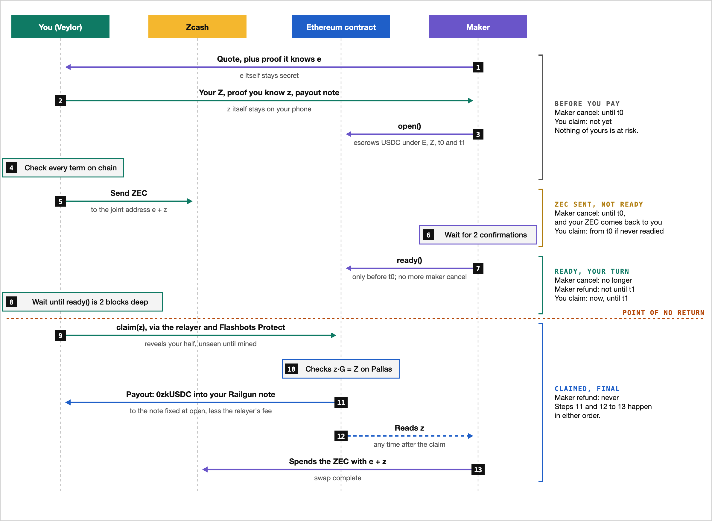

# ZecSwap

Swap shielded ZEC for USDC on Ethereum, and back, without trusting the other side. Your ZEC never
leaves Zcash's shielded pool, your USDC lands in your private [Railgun](https://railgun.org)
balance, and no Ethereum account of yours appears on-chain. Nobody holds the funds in between:
every swap either completes or unwinds.

In beta on Ethereum mainnet, and not yet externally audited. The live contract, since 2026-10-22,
is [`0xeB3A00bcB6c9fF626fE57a5dBbDCf01730e7898f`](https://etherscan.io/address/0xeB3A00bcB6c9fF626fE57a5dBbDCf01730e7898f).
The Sepolia testnet runs the same contract, with shorter windows, at
[`0x459b0a69e0f736666b66a3ffe0fc17c11f05980d`](https://sepolia.etherscan.io/address/0x459b0a69e0f736666b66a3ffe0fc17c11f05980d).
The [Veylor](https://veylor.cash) wallet runs the user's side.

## How it works

The ZEC goes to a fresh shielded address whose spend key is split in two: the maker holds one
half, `e`, and you hold the other, `z`. Spending the ZEC takes both. The maker's USDC waits in an
Ethereum contract that knows only the public points of the two halves, `E = e·G` and `Z = z·G` on
the Pallas curve.

The contract pays whichever side reveals its half, once it checks the half against its point.
Revealing a half is also what hands the other side the ZEC:

- **You reveal `z`** to claim. The USDC is shielded into the Railgun note you chose before the
  swap opened, and the maker adds `z` to `e` and takes the ZEC.
- **The maker reveals `e`** to cancel or refund. Its USDC goes back to it, and your wallet adds
  `e` to `z` and takes your ZEC back.

Once one half is revealed the swap is settled, so every swap ends one of these two ways.

### A swap, step by step

1. **Quote.** The maker quotes a price and proves it knows `e` without revealing it. You answer
   with `Z`, a proof you know `z`, and the Railgun note your USDC must be paid to.
2. **Open.** Before you send anything, the maker locks the USDC in the contract under `E`, `Z`,
   two deadlines (`t0` and `t1`) and your payout note.
3. **Check and pay.** Your wallet reads the swap back from Ethereum and sends the ZEC to the
   joint address only if every term matches.
4. **Ready.** Once the ZEC has 2 confirmations, the maker calls `ready()`, giving up its right to
   cancel.
5. **Claim.** A relayer sends your claim, which reveals `z`, through Flashbots Protect, so `z`
   stays out of the public mempool until it is mined. Then the relayer shields the USDC into your
   note, keeping the fee you signed for, so you never need ETH.
6. **Settle.** With `z` public, the maker spends the ZEC.

<picture>
  <source media="(prefers-color-scheme: dark)" srcset="docs/images/swap-flow-dark.png">
  
</picture>

A wallet can also hand its claim to the relayer early, for the relayer to send the moment the
claim's window opens, so you can close the app; the relayer holds `z` until then. Hand it over
only once the swap is ready: until then the maker may cancel, and its `e` with your `z` would let
the relayer alone spend the deposit.

### Who may act, and when

The deadlines cut every swap into windows, and in each only one side may reveal. No reveal can be
raced, and one held up in the mempool still lands any time before its window closes.

| | Until `t0` | `t0` to `t1` | `t1` to `t1` + 24 h | After that |
|---|---|---|---|---|
| **Not ready** | The maker may cancel | You may claim | The maker may refund | You may claim |
| **Ready** | You may claim | You may claim | The maker may refund | You may claim |

The maker can make a swap ready only before `t0`. On mainnet the contract refuses to open a swap
that leaves less than an hour before `t0`, or between `t0` and `t1`, and the maker's refund window
lasts 24 hours (an hour on the testnet).

### When something goes wrong

| What happens | How it ends |
|---|---|
| You don't pay, or pay too little | The maker cancels before `t0`, and any ZEC you sent comes back |
| The maker goes quiet after you pay | You claim without it from `t0` |
| You haven't claimed by `t1` | The maker refunds and your ZEC comes back; if it hasn't within 24 hours, you may claim again |
| Railgun sends the payout back | It returns to the swap's own vault, and you can shield it again |

## More in the docs

| Doc | What it covers |
|---|---|
| [Reverse flow](docs/reverse-flow.md) | USDC to ZEC: you escrow USDC straight from Railgun, the maker sends ZEC to the joint address, you confirm it arrived, and the maker reveals its half to take the USDC |
| [Deposits](docs/deposits.md) | Public USDC taken at a wallet's own deposit addresses and shielded into its Railgun balance |
| [Railgun sends](docs/railgun-sends.md) | Private sends and withdrawals the relayer broadcasts for wallets with no ETH |
| [Tokens](docs/tokens.md) | Privacy Pass tokens that limit how many swaps a device can walk away from each day |

## Repository layout

This repo is the protocol and your side of it: the contracts, and everything a wallet builds on.
The maker, the relayer and the token issuer are services, and their code is not here. Your wallet
doesn't take their word for anything: it checks every term against the contract before it pays.

| Path | What it is |
|---|---|
| `contracts` | Foundry: `ZecSwap.sol`, the swaps; `ShieldVault.sol`, each swap's Railgun payout vault; `Deposits.sol`, deposit addresses' USDC into Railgun; `Pallas.sol`, the curve check |
| `crates/zecswap-core` | The split key: joint account, proofs of knowledge, seed-derived shares, and signing Zcash spends (PCZTs) with `±(e + z)` |
| `crates/zecswap-chain` | Zcash light wallet (sync, joint accounts, sweeps) and the Ethereum contract client |
| `crates/zecswap-railgun` | Railgun keys, `0zk` addresses and the shield notes payouts go to, checked against Railgun's own engine |
| `crates/zecswap-client` | The user's side, step by step, in both directions: the reference wallets follow |
| `crates/zecswap-api` | The maker's and relayer's HTTP APIs, as wallets speak them |
| `crates/zecswap-tokens` | Privacy Pass tokens: fetching, spending and checking them |
| `crates/zecswap-jni` | The Android bindings, built as `libzecswap.so` |
| `crates/zecswap-cli` | A testnet wallet and swap CLI |

## Build and test

You need Rust (pinned in `rust-toolchain.toml`) and [Foundry](https://getfoundry.sh).

```sh
(cd contracts && forge build && forge test)   # build the contracts, then their unit, fuzz and invariant tests
cargo test --workspace                        # crypto, the audit's cases, Ironwood spends with real proofs, and EVM tests on local anvils
cargo build --release -p zecswap-core --example evm_vectors
(cd contracts && FOUNDRY_PROFILE=ffi forge test)   # Pallas.sol fuzzed against the Rust implementation
```

A testnet wallet, to try the user's side:

```sh
cargo run -p zecswap-cli -- --data-dir .testnet/user init     # prints the address to fund
cargo run -p zecswap-cli -- --data-dir .testnet/user status
```

## Deploying the contract

Deploy the contract with `contracts/script/Deploy.s.sol`, on mainnet with
`scripts/deploy-contract.sh`. On Sepolia, whose repricing `forge script` misjudges, send the
creation with `cast send --create` at the node's gas estimate.

## License

Apache-2.0: see [`LICENSE`](LICENSE).
